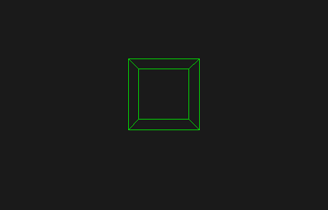

# 3D Software-Renderer in Rust-TDD

## ***Demo***

---

Ein eigenständiges Übungsprojekt zur Implementierung einer dreidimensionalen Grafik-Engine von Grund auf in Rust. Das Projekt verzichtet konsequent auf externe Mathematik- oder Grafik-Bibliotheken (Zero-Crates-Ansatz), um die zugrundeliegende lineare Algebra, die Rendering-Pipeline und Algorithmen vollständig im Eigenbau zu durchdringen.

## Projektauftrag und Zielsetzung

Das Ziel dieses Projekts ist die Entwicklung eines funktionsfähigen Software-Renderers, der 3D-Drahtgittermodelle (Wireframes) im Raum mathematisch transformiert, rotiert und korrekt perspektivisch auf einen zweidimensionalen Bildschirm projiziert. 

Die Anzeige erfolgt über das Crate `minifb`, welches ausschließlich als primitiver Framebuffer genutzt wird. Das bedeutet, dass sämtliche Berechnungen – vom Setzen einzelner Pixel im Speicher über das Zeichnen von Linien bis hin zu Matrix-Multiplikationen – selbst programmiert werden.

## Technische Kernkomponenten

Das System wird strikt nach der Test-Driven Development (TDD) Methodik aufgebaut und gliedert sich in folgende mathematische und architektonische Bereiche:

1. Vektor- und Matrix-Arithmetik: Implementierung eigener mathematischer Strukturen für 3D-Vektoren (Vector3D) und 4x4-Transformationsmatrizen (Matrix4D). Dies umfasst die Vektoraddition, Skalierung, das Kreuzprodukt sowie Matrix-Matrix- und Matrix-Vektor-Multiplikationen.
2. Transformations-Pipeline: Berechnung von Rotationsmatrizen (X-, Y- und Z-Achse), Translationsmatrizen (Verschiebung im Raum) und Skalierungsmatrizen zur dynamischen Manipulation von 3D-Objekten.
3. Perspektivische Projektion: Mathematische Transformation von dreidimensionalen Weltkoordinaten in zweidimensionale Bildschirmkoordinaten unter Berücksichtigung des Sichtfeldes (Field of View) und des Seitenverhältnisses (Aspect Ratio).
4. Rasterisierung (Bresenham-Algorithmus): Implementierung eines effizienten, ganzzahlbasierten Algorithmus zur Interpolation und zum Zeichnen von Linien zwischen zwei Punkten direkt in den zweidimensionalen Pixel-Buffer.

## Entwicklungsmethodik (TDD)

Der gesamte mathematische Kern sowie die Projektionslogik werden stufenweise nach dem Prinzip Red-Green-Refactor entwickelt. Da das Projekt ohne Third-Party-Crates auskommt, stellt die lückenlose Test-Suite die absolute mathematische Korrektheit der Rotationen und Projektionen sicher, bevor die Daten an den Framebuffer übergeben werden.

## Der Weg einer einzelnen Linie auf den Bildschirm

Jede Kante besteht aus einem Start- und einem Endpunkt. Die Pipeline verarbeitet diese in fünf Schritten:

1. **Raum-Transformation**
   * **Methode:** `welt_matrix.multipliziere_punkt()`
   * **Prinzip:** Rotiert und verschiebt die beiden 3D-Punkte an die aktuelle Position im virtuellen Raum.

2. **Kamera-Projektion**
   * **Methode:** `projektion.multipliziere_vektor_homogen()`
   * **Prinzip:** Wendet das Sichtfeld an und speichert die Tiefeninformation in der Komponente (`w`) ab.

3. **Perspektivische Division**
   * **Methode:** `homogen_punkt.zu_ndc_space()`
   * **Prinzip:** Teilt die Raumkoordinaten durch `w`. Entfernte Punkte rücken näher zusammen.

4. **Viewport-Mapping**
   * **Methode:** `viewport.transformiere()`
   * **Prinzip:** Rechnet die standardisierten Raumwerte in echte 2D-Fensterpixel um.

5. **Rasterisierung & Zeichnen**
   * **Methode:** `bresenham_linie()`
   * **Prinzip:** Berechnet die Pixel-Kette zwischen den beiden Ziel-Koordinaten. Die ermittelten Indizes werden im `framebuffer` auf Grün (`0x00FF00`) gesetzt.

